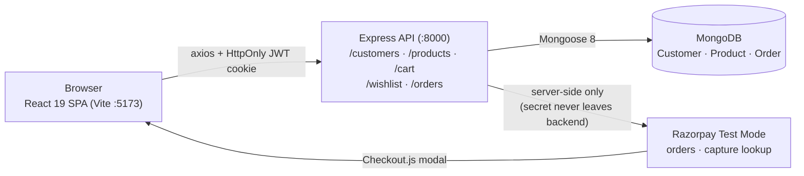
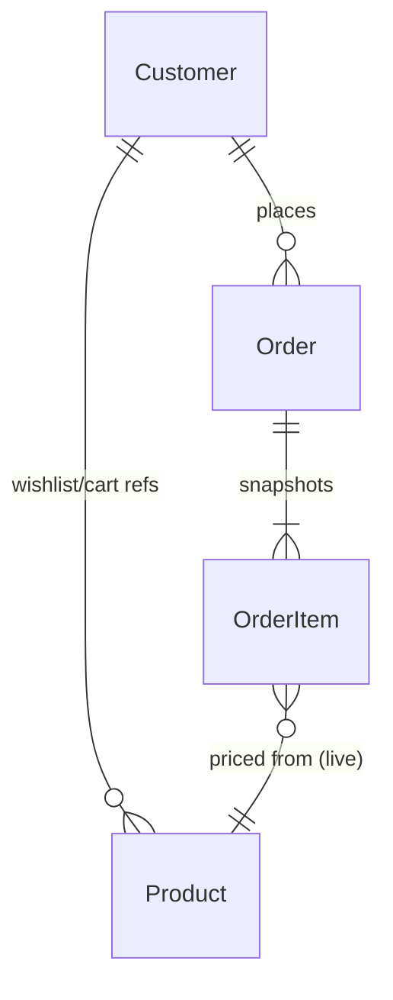

# 🛒 ShopKart — your neighbourhood store, online

A full-stack MERN e-commerce application: browsable catalog, stock-checked cart, wishlist,
Razorpay (Test Mode) checkout, and order tracking — with cookie-based JWT authentication
throughout. Built incrementally across six engineering labs, from auth foundations to
payments hardening.


> **Status:** working local-development project. No CI, no license file, no deployment
> configuration — see [Testing and quality](#testing-and-quality) and [License](#license).

## Contents

- [Features](#features)
- [Tech stack](#tech-stack)
- [Architecture](#architecture)
- [Repository structure](#repository-structure)
- [API reference](#api-reference)
- [Authentication](#authentication)
- [Data models](#data-models)
- [Configuration](#configuration)
- [Local setup](#local-setup)
- [Scripts and workflow](#scripts-and-workflow)
- [Testing and quality](#testing-and-quality)
- [Troubleshooting](#troubleshooting)
- [Security notes](#security-notes)
- [Contributing](#contributing)
- [License](#license)
- [Potential future improvements](#potential-future-improvements)

## Features

Everything below was verified against the source code and, where noted, against a live run.

### Shopping experience

| Feature | Status | Notes |
|---|---|---|
| Product listing | Implemented | `GET /products` with `search` (escaped, case-insensitive name match), `category` (exact, case-insensitive), `sort=price_asc\|price_desc` |
| Product details | Implemented | `GET /products/:id` with 400 (bad id) / 404 handling; related-items shelf by category |
| Header search with suggestions | Implemented | Debounced, keyboard-navigable, stale-response guarded; uses the same `GET /products?search=` endpoint |
| Price & availability filters | Implemented | Client-side refinement over the fetched set; mobile filter drawer |
| Cart | Implemented | Add / set-quantity / remove; **atomic stock-checked increments** (`$elemMatch` guard — concurrent adds can't overshoot stock); totals derived from server-populated prices |
| Wishlist | Implemented | Add / remove / toggle; populated product docs; navbar count synced via event |
| Checkout | Implemented | Shipping-address validation, Razorpay Checkout.js, HMAC-verified confirmation; cart clears only on verified success |
| Payment recovery | Implemented | `POST /orders/:id/sync` re-checks capture state; explicit failures trigger best-effort `cancel` so orders don't linger payable |
| Order history & details | Implemented | Status tracker (PLACED → CONFIRMED → SHIPPED → DELIVERED), payment badges |
| Fulfilment | Implemented, admin-only | `PATCH /orders/:id/status` requires `x-admin-key`; buyers can never advance their own orders |
| Responsive + accessible UI | Implemented | ~380px → 1440px layouts, skip link, focus rings, ARIA live regions, `prefers-reduced-motion` support |
| Loading / empty / error states | Implemented | Skeletons, retryable errors, honest empty states on every data page |

### Account & authentication

| Feature | Status | Notes |
|---|---|---|
| Registration | Implemented | `POST /customers/register`; 409 on duplicate email; then sign in on `/login` |
| Login / logout | Implemented | JWT in **HttpOnly, SameSite=Lax** cookie (7 days); logout endpoint intentionally public so it always clears the cookie |
| Session persistence | Implemented | `AuthContext` hydrates via `GET /customers/me` on app load |
| Route protection | Implemented | `ProtectedRoute` (guests → `/login`) and `PublicRoute` (signed-in users leave `/login`); signed-in 404 page |
| Password change | Implemented (API) | `PATCH /customers/change-password` (auth required, bcrypt-verified) — **no frontend UI yet** |
| Password recovery / OTP / social login | Not present | Deliberately absent from UI; no dead links |

### Backend capabilities

- REST API on Express 4 with Mongoose 8 models and validation.
- Auth middleware (`isAuthenticated`) resolving the cookie JWT to `req.user`.
- Server-computed order totals from live product prices; client-sent totals ignored.
- One-pending-checkout-per-user guard (409 "already in progress") plus a partial unique index backstop.
- Razorpay Test-Mode integration with lazy client init and a clear 503 when keys are missing.
- Product creation endpoint (`POST /products`) exists for seeding/admin use.

## Tech stack

| Role | Technology | Purpose in this project |
|---|---|---|
| UI framework | React 19 + React DOM | All pages and components |
| Routing | react-router-dom 7 | Public/protected routes, deep-linkable search & category URLs, lazy route splitting |
| HTTP client | axios 1 | Central instance (`frontend/src/services/api.js`) with `baseURL: http://localhost:8000`, `withCredentials: true` |
| State | React Context | `AuthContext` (session), `CartContext` (single cart truth, derived count/subtotal), toast bus |
| Styling | Hand-written CSS + design tokens | `frontend/src/index.css` — warm-paper / deep-green system, Fraunces + Inter |
| Build / dev server | Vite | Dev on `:5173` (strict port), production build, route-level code splitting |
| Lint | oxlint | React + oxc rules (`react/rules-of-hooks` as error) |
| API framework | Express 4 | Five routers mounted in `backend/index.js` |
| Database | MongoDB via Mongoose 8 | `Customer`, `Product`, `Order` models |
| Auth | jsonwebtoken 9 + bcrypt 6 | 7-day JWT in HttpOnly cookie; bcrypt cost-10 password hashes |
| Payments | Razorpay SDK 2 (Test Mode) | Server-side order creation, signature verification, capture sync |
| Config | dotenv 17 | `backend/.env` (gitignored; see `backend/.env.example`) |
| Runtime (observed) | Node.js v24.12.0 | Version used to verify this README |

## Architecture



**Request flow (cart add):** click → `CartContext.addItem` → `services/cart.js` →
`POST /cart/:productId` → `isAuthenticated` → atomic stock-checked update →
populated cart → context recomputes count/subtotal → Navbar, cards, and cart page re-render from the single source of truth.

**Checkout flow:** address form → `POST /orders/create-payment-order`
(server-computed total, one-pending guard, 503 without Razorpay keys) → Razorpay
modal → `POST /orders/verify-payment` (HMAC check; cart clears **only here**) →
`/order-success/:id`. Dropped verifications recover via `POST /orders/:id/sync`.

## Repository structure

```text
.
├── backend/
│   ├── index.js                  # Express boot: CORS (:5173 + credentials),
│   │                             # JSON + cookie parsing, five routers, :8000
│   ├── routes/                   # cart, customer, order, product, wishlist
│   ├── controllers/              # request handling + business logic
│   ├── models/                   # Customer, Product, Order (Mongoose)
│   ├── middlewares/auth.middleware.js  # cookie-JWT → req.user (401s)
│   ├── config/razorpay.js        # lazy Test-Mode client (null when unconfigured)
│   ├── utils/generateToken.js    # 7-day JWT signer
│   └── .env.example              # required/optional variables (placeholders only)
└── frontend/
    ├── src/
    │   ├── pages/                # Login, Register, Home, Products, ProductDetails,
    │   │                         # Cart, Checkout, Wishlist, Orders, OrderDetails,
    │   │                         # OrderSuccess, NotFound
    │   ├── components/           # Navbar, ProductCard, CartItem, SearchBar, Rail,
    │   │                         # Reveal, Footer, Toast, ui.jsx primitives, …
    │   ├── context/              # AuthContext, CartContext
    │   ├── services/             # api.js + thin cart/wishlist/orders wrappers
    │   ├── App.jsx               # providers, lazy routes, 404 handling
    │   └── index.css             # the ShopKart design system
    ├── index.html                # title, meta, fonts (Fraunces + Inter)
    └── vite.config.js            # dev server :5173 strictPort
```

> The git history (`Lab_01_Finished` … `Lab_06_Finished`) shows the incremental build:
> auth → catalog → storefront → wishlist → cart → payments hardening.

## API reference

Base URL `http://localhost:8000`. Auth = `isAuthenticated` (cookie JWT) unless noted.

| Method | Endpoint | Purpose | Auth |
|---|---|---|---|
| POST | `/customers/register` | Create account (`fullName, email, password, phone`); 409 on duplicate | — |
| POST | `/customers/login` | Verify credentials; set HttpOnly cookie; 401 on failure | — |
| POST | `/customers/logout` | Clear cookie (public so it always succeeds) | — |
| GET | `/customers/me` | Current session customer | ✅ |
| PATCH | `/customers/change-password` | Rotate password (old verified with bcrypt) | ✅ |
| GET | `/products` | List; `?search=&category=&sort=price_asc\|price_desc` | — |
| GET | `/products/:id` | One product; 400/404 on bad/missing id | — |
| POST | `/products` | Create product (seeding/admin; no frontend UI) | — |
| GET | `/cart` | Populated cart | ✅ |
| POST | `/cart/:productId` | Add / increment (stock-checked, atomic) | ✅ |
| PATCH | `/cart/:productId` | Set `{quantity}` (stock-checked) | ✅ |
| DELETE | `/cart/:productId` | Remove line | ✅ |
| GET | `/wishlist` | Populated wishlist + count | ✅ |
| POST | `/wishlist/:productId` | Save | ✅ |
| DELETE | `/wishlist/:productId` | Unsave | ✅ |
| PATCH | `/wishlist/:productId/toggle` | Save/unsave flip (`{saved}`) | ✅ |
| POST | `/orders/create-payment-order` | Reserve order + Razorpay order (503 without keys; 409 if one pending) | ✅ |
| POST | `/orders/verify-payment` | HMAC-verify, mark PAID, clear cart | ✅ |
| POST | `/orders/:id/sync` | Re-check capture state server-side | ✅ |
| POST | `/orders/:id/cancel` | Mark a pending order FAILED | ✅ |
| GET | `/orders` | Own order history | ✅ |
| GET | `/orders/:id` | Own order detail (404 otherwise) | ✅ |
| PATCH | `/orders/:id/status` | Advance fulfilment — `x-admin-key` required | ✅ + key |

## Authentication

1. **Register** → bcrypt hash (cost 10) → `201`; duplicate email → `409 "Email already exists"`.
2. **Login** → `bcrypt.compare` → `jwt.sign({userId}, 7d)` → `Set-Cookie: token=…; HttpOnly; SameSite=Lax; Max-Age=7d`.
3. **Session** — every protected call sends the cookie automatically (`withCredentials`);
   middleware verifies it, loads the customer (`-password`), and attaches `req.user`.
4. **Frontend** — `AuthContext` hydrates from `/me`; `ProtectedRoute`/`PublicRoute` guard navigation.
5. **Logout** — clears the cookie even with an expired/invalid token.

## Data models

- **Customer** — `fullName, email (unique, lowercase), password (hashed), phone`,
  `wishlist: [ObjectId→Product]`, `cart: [{product→Product, quantity≥1 integer}]`, timestamps.
- **Product** — `name, description, price (>0), category, image, stock (≥0)`, timestamps.
- **Order** — `user→Customer`, embedded item snapshots (`product, name, price, quantity, image`
  — history survives repricing/deletion), `shippingAddress`, server-computed `totalAmount`,
  `paymentStatus: PENDING|PAID|FAILED`, `status: PENDING_PAYMENT|PLACED|CONFIRMED|SHIPPED|DELIVERED`,
  Razorpay ids; partial unique index allows only one `PENDING` order per user.



## Configuration

| Variable | Required? | Used by | Description |
|---|---|---|---|
| `dbURL` (or `MONGO_URI`) | ✅ | backend | MongoDB connection string |
| `JWT_SECRET` | ✅ | backend | Signs/verifies session JWTs |
| `RAZORPAY_KEY_ID` | For checkout | backend | Test-Mode key id (only this ever reaches the frontend) |
| `RAZORPAY_KEY_SECRET` | For checkout | backend | Stays server-side; missing keys → clean 503, boot unaffected |
| `ADMIN_KEY` | For fulfilment | backend | Compared against the `x-admin-key` header |

Copy `backend/.env.example` to `backend/.env` and fill values. Never commit `.env`
(it is gitignored). The frontend needs no env file — the API URL is fixed in
`frontend/src/services/api.js`.

## Local setup

Prerequisites: **Node.js** (v24 verified), **npm**, a **MongoDB** instance (Atlas or local).

```bash
# 1. Backend
cd backend
npm install
cp .env.example .env        # then fill dbURL + JWT_SECRET (+ Razorpay test keys for checkout)
npm run dev                 # node --watch index.js → http://localhost:8000

# 2. Frontend (new terminal)
cd frontend
npm install
npm run dev                 # vite → http://localhost:5173
```

Open `http://localhost:5173`, register an account, and shop. The API must stay on
`:8000` — CORS allows only `http://localhost:5173` with credentials. Product images
are remote Unsplash URLs, so the catalog needs internet access to look its best.

## Scripts and workflow

| Directory | Command | Purpose |
|---|---|---|
| `backend` | `npm run dev` | Watch-mode API on `:8000` |
| `backend` | `npm start` | Plain `node index.js` |
| `backend` | `npm test` | ⚠️ currently fails — test file was removed (see below) |
| `frontend` | `npm run dev` | Vite dev server, strict port `5173` |
| `frontend` | `npm run build` | Production build to `frontend/dist` |
| `frontend` | `npm run preview` | Serve the production build locally |
| `frontend` | `npm run lint` | oxlint (hooks rule is an error; some warnings remain) |

## Testing and quality

- **Backend tests:** none present — `npm test` points at the deleted
  `tests/lab06-hardening.test.mjs` and errors with `MODULE_NOT_FOUND`. The deletion
  predates this documentation and was left untouched.
- **Frontend tests:** no test runner is configured.
- **What is verified:** `vite build` ✅ (observed passing), `oxlint` ✅ (warnings only,
  no errors), plus live end-to-end API checks (register → login → wishlist/cart ops →
  order reads; 401/400/404/409 paths) run during development.

## Troubleshooting

| Symptom | Likely cause → fix |
|---|---|
| `EADDRINUSE :::8000` / `:5173` | Server already running → stop the old process; ports are locked by design |
| `Missing required environment variables: dbURL` | No `backend/.env` → copy from `.env.example` |
| API `401 Login required` in UI | Cookie missing/expired → log in again; ensure requests use `withCredentials` (the shared client does) |
| Checkout error about payments not enabled (503) | `RAZORPAY_KEY_ID/SECRET` absent → add Test-Mode keys and restart backend |
| `409 Email already exists` on register | Expected duplicate handling → log in instead |
| `409 A checkout is already in progress` | One pending order per user → complete/cancel it first |
| Blank product images | Remote Unsplash URLs unreachable offline; the UI renders a monogram fallback tile |
| `npm test` module-not-found | Test file was deleted from the repo; nothing to run until tests are re-added |
| Login loops back to `/login` | Backend down or CORS mismatch → confirm API on `:8000` and origin `http://localhost:5173` |

## Security notes

Implemented: bcrypt password hashing, HttpOnly + SameSite=Lax session cookies,
server-side price/stock/total authority, signature-verified payments, admin-key-gated
fulfilment, frontend/backend route guards. General guidance: keep `.env` uncommitted,
use HTTPS and a restrictive CORS origin in production, and never expose Razorpay secrets
to the client.

Two observations for future hardening (documented, not changed): `POST /products` has
no authentication, and the logout cookie clear uses `secure: false`, which suits local
HTTP but must be revisited for HTTPS deployments.

## Contributing

Small, focused PRs against `main` are welcome. Useful check before pushing:

```bash
cd frontend && npm run lint && npm run build
```

Keep backend/frontend boundaries intact: the frontend adapts to API contracts, never
the reverse. Don't commit `.env`, dumps, or credentials.

## License

No license file exists in this repository. Until one is added, the code is **not**
licensed for reuse — maintainers should clarify the licensing status.

## Potential future improvements

Ideas only — none of this is committed or planned:

- Re-add the backend hardening test suite (`npm test` currently has no target).
- Frontend UI for `change-password` and admin fulfilment (both API-ready).
- Pagination/virtualization if the catalog outgrows full-list fetching.
- Refresh-token rotation and `Secure` cookie flag for production HTTPS.
- Authenticated/limited product management to replace the open `POST /products`.
- CI (build + lint), a license file, and deployment docs.

---

*Screenshots: none ship with the repo yet. Genuine captures can live under
`docs/screenshots/` and be embedded here when available — no placeholders were invented.*
